<p align="center">
  <a href="https://theagencymge.github.io/auralis/">
    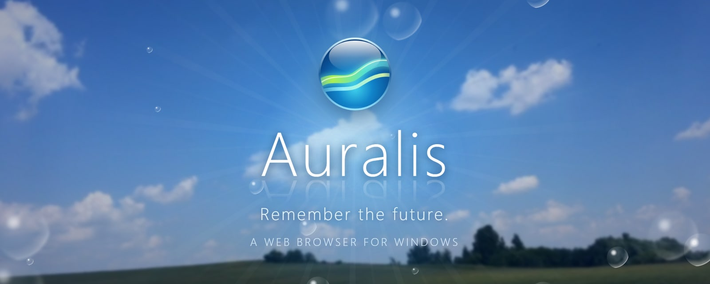
  </a>
</p>

<p align="center">
  <b>A web browser for Windows that looks the way the 2000s said computers would look.</b><br>
  Glossy, bright and full of sky.
</p>

<p align="center">
  <a href="https://github.com/TheAgencyMGE/auralis/releases/latest"></a>
  
  <a href="LICENSE"></a>
  
</p>

<p align="center">
  <a href="https://theagencymge.github.io/auralis/"><b>Website</b></a> &nbsp;·&nbsp;
  <a href="https://github.com/TheAgencyMGE/auralis/releases/latest"><b>Download</b></a> &nbsp;·&nbsp;
  <a href="https://theagencymge.github.io/auralis/#trailer"><b>Trailer</b></a> &nbsp;·&nbsp;
  <a href="#screenshots"><b>Screenshots</b></a>
</p>

---

## The trailer

<p align="center">
  <a href="https://theagencymge.github.io/auralis/#trailer">
    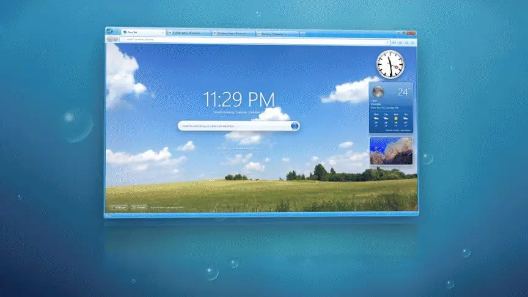
  </a>
  <br>
  <sub>Click to watch the full trailer with sound, or <a href="site/media/auralis-trailer.mp4">download it</a>.</sub>
</p>

## Two looks, one browser

Pick one in **Settings → Look**. You can switch whenever you like.

<table>
  <tr>
    <td width="50%">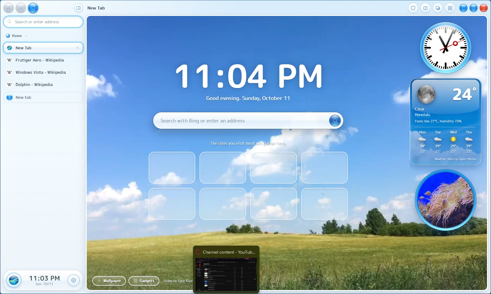</td>
    <td width="50%">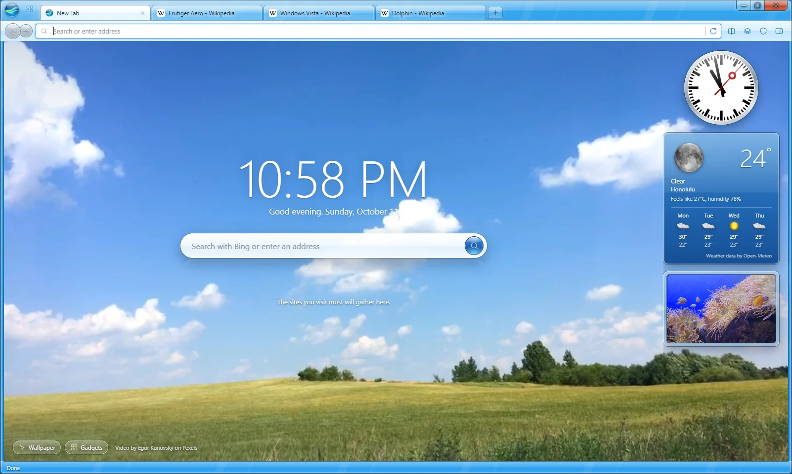</td>
  </tr>
  <tr>
    <td><b>Aqua</b> (default)<br>Tabs down the side, pinned tabs as Wii-style channels, candy-blue gel buttons, a rounded font and a clock along the bottom.</td>
    <td><b>Modern</b><br>Vista glass with tabs on top, a toolbar, a favorites bar and a status bar. Your desktop shows through the frame.</td>
  </tr>
</table>

## What's inside

<table>
  <tr>
    <td width="64" align="center">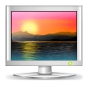</td>
    <td><b>Live wallpapers.</b> New tabs open on real looping footage: dolphins, rain on glass, wind farms, northern lights, a koi pond. Add your own photos and videos too.</td>
  </tr>
  <tr>
    <td align="center"></td>
    <td><b>Gadgets.</b> A railway clock in a glass bubble, weather over a real sky, a slide show, news headlines, currency rates on a green LCD, a fishbowl and sticky notes. Keep them on new tabs or in a panel beside any page.</td>
  </tr>
  <tr>
    <td align="center">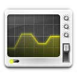</td>
    <td><b>Flip 3D and Tab Flip.</b> Scroll through your tabs as a tilted stack, Vista style, or search them in a grid.</td>
  </tr>
  <tr>
    <td align="center"></td>
    <td><b>Ad and tracker blocking.</b> Built in, with HTTPS-First and Global Privacy Control. One click turns it off for a site.</td>
  </tr>
  <tr>
    <td align="center"></td>
    <td><b>Dangerous site warnings.</b> Known phishing and malware sites get a red stop page. The lists live on your computer, so the sites you visit are never sent anywhere to be checked.</td>
  </tr>
  <tr>
    <td align="center"></td>
    <td><b>Chrome extensions.</b> Install them from the Chrome Web Store, where the button reads "Add to Auralis". Their toolbar buttons and popups work like they do in Chrome.</td>
  </tr>
  <tr>
    <td align="center">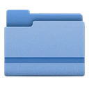</td>
    <td><b>Spaces and split view.</b> Separate sets of tabs for work and play, and two pages side by side.</td>
  </tr>
  <tr>
    <td align="center">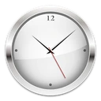</td>
    <td><b>Sleeping tabs.</b> Tabs you haven't looked at in a while give their memory back and wake up right where you left them.</td>
  </tr>
  <tr>
    <td align="center">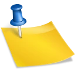</td>
    <td><b>The little things.</b> Reader view, screenshots, QR codes, picture-in-picture, a feed reader, a media player in the status bar, a pop-up blocker with IE's yellow bar, a startup chime and a Welcome Center.</td>
  </tr>
</table>

## Screenshots

<table>
  <tr>
    <td>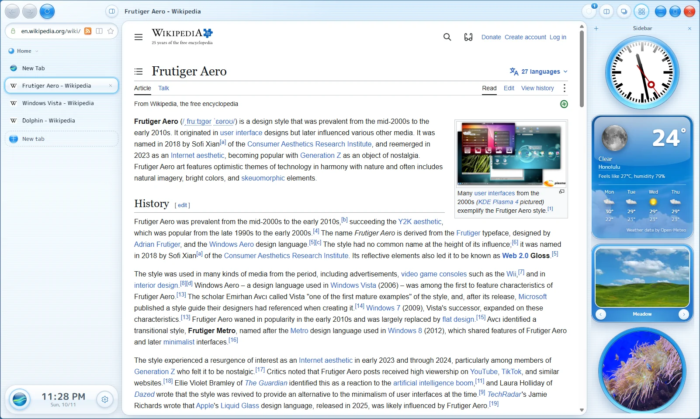</td>
    <td>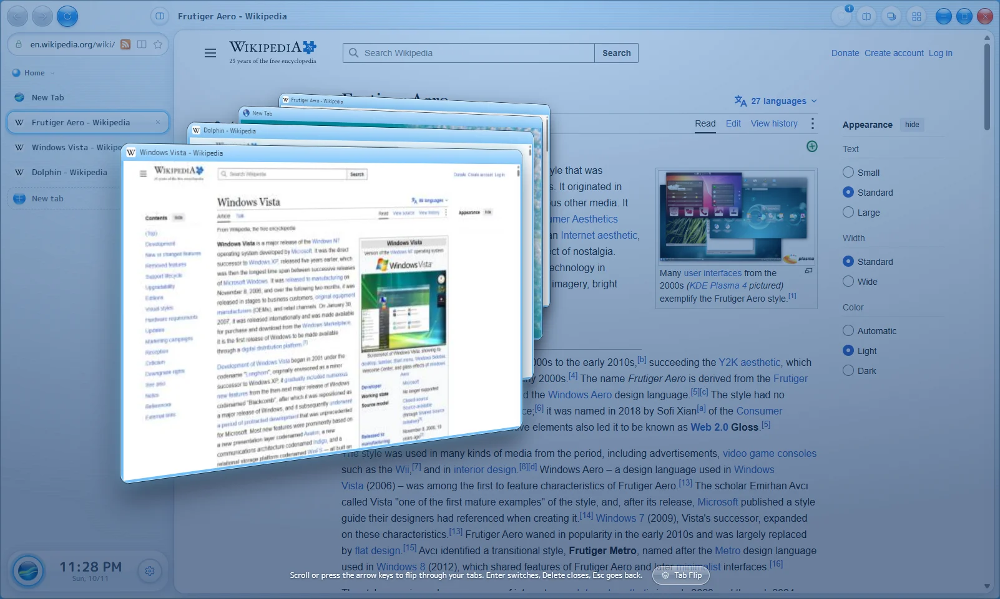</td>
  </tr>
  <tr>
    <td align="center"><sub>Gadgets beside any page</sub></td>
    <td align="center"><sub>Flip 3D</sub></td>
  </tr>
  <tr>
    <td>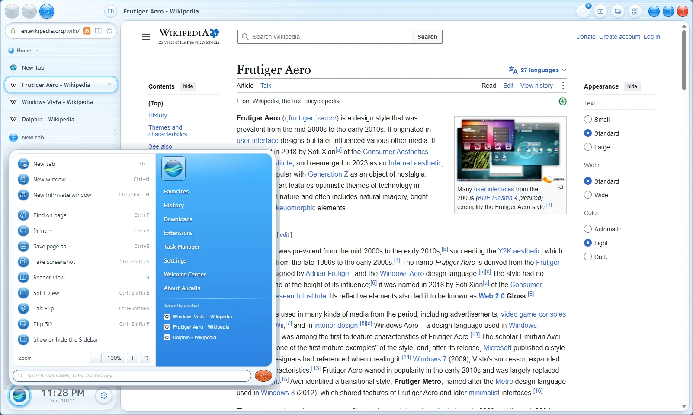</td>
    <td>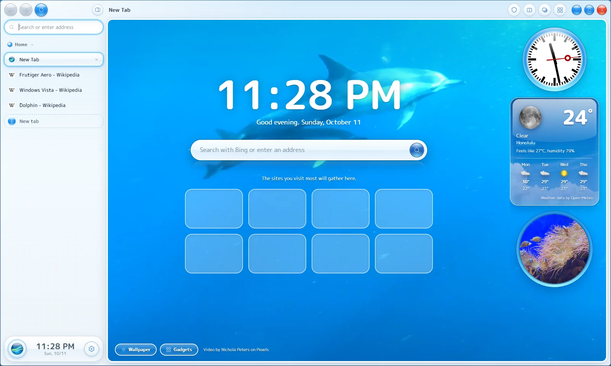</td>
  </tr>
  <tr>
    <td align="center"><sub>The Auralis menu</sub></td>
    <td align="center"><sub>A live wallpaper</sub></td>
  </tr>
  <tr>
    <td>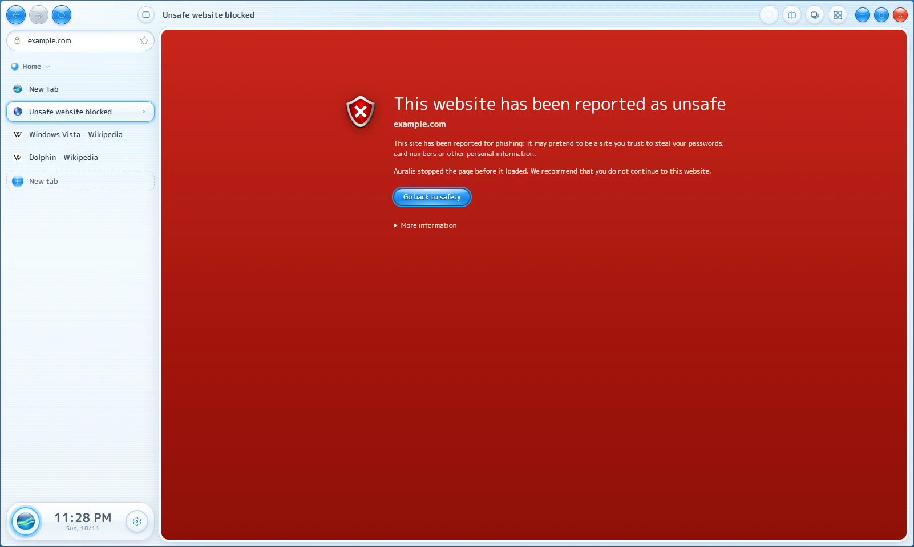</td>
    <td>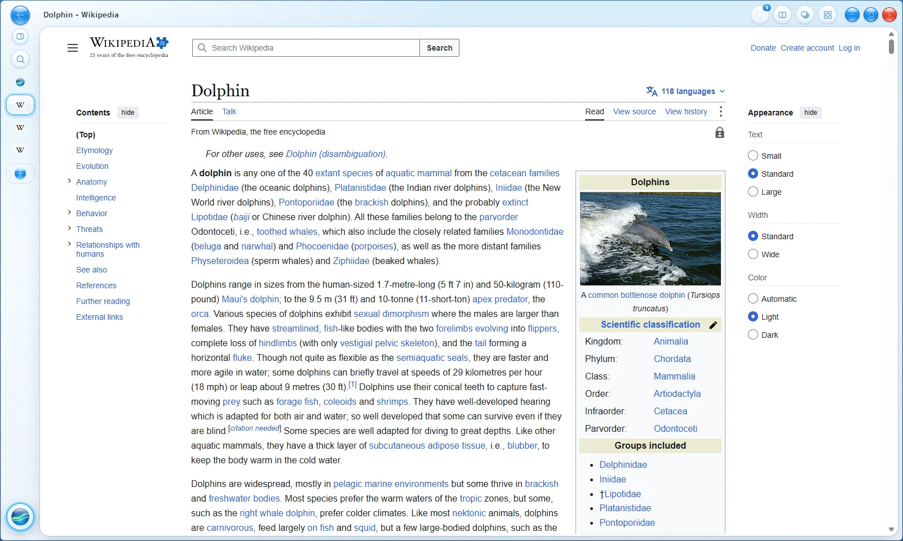</td>
  </tr>
  <tr>
    <td align="center"><sub>Stopped before it loads</sub></td>
    <td align="center"><sub>The compact sidebar</sub></td>
  </tr>
  <tr>
    <td>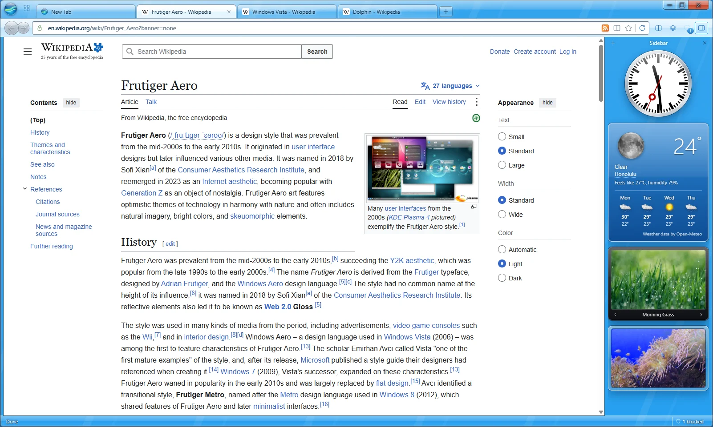</td>
    <td>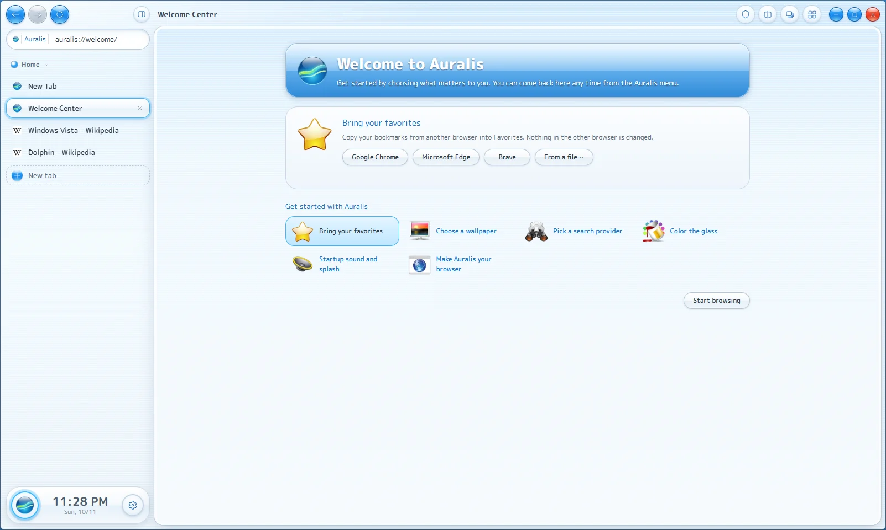</td>
  </tr>
  <tr>
    <td align="center"><sub>Modern, with the gadget panel</sub></td>
    <td align="center"><sub>The Welcome Center</sub></td>
  </tr>
</table>

## Install

1. Download the installer from the [latest release](https://github.com/TheAgencyMGE/auralis/releases/latest).
2. Run it. The installer isn't code-signed yet, so Windows SmartScreen may stop it. Click **More info**, then **Run anyway**.
3. The Welcome Center opens on first start. It can bring your favorites over from Chrome, Edge or Brave.

Auralis runs on Windows 10 and 11, 64-bit.

## Build it yourself

You need [Node.js](https://nodejs.org) 22 or newer.

```bash
git clone https://github.com/TheAgencyMGE/auralis.git
cd auralis
npm install
npm run dev
```

| Command | What it does |
| --- | --- |
| `npm run dev` | Starts Auralis with hot reload |
| `npm test` | Runs the unit tests |
| `npm run test:e2e` | Builds the app and runs the Playwright end-to-end tests |
| `npm run dist` | Type checks, tests, builds and makes the installer in `dist/` |

[docs/ARCHITECTURE.md](docs/ARCHITECTURE.md) explains how the pieces fit together.

## Handy shortcuts

| Keys | Action |
| --- | --- |
| <kbd>Ctrl</kbd> + <kbd>T</kbd> / <kbd>Ctrl</kbd> + <kbd>W</kbd> | New tab / close tab |
| <kbd>Ctrl</kbd> + <kbd>Shift</kbd> + <kbd>T</kbd> | Reopen the last closed tab |
| <kbd>Ctrl</kbd> + <kbd>L</kbd> | Go to the address bar |
| <kbd>Ctrl</kbd> + <kbd>K</kbd> | Command palette |
| <kbd>Ctrl</kbd> + <kbd>Shift</kbd> + <kbd>F</kbd> | Flip 3D |
| <kbd>Ctrl</kbd> + <kbd>Shift</kbd> + <kbd>A</kbd> | Tab Flip |
| <kbd>Ctrl</kbd> + <kbd>Shift</kbd> + <kbd>E</kbd> | Split view |
| <kbd>F9</kbd> | Reader view |
| <kbd>Ctrl</kbd> + <kbd>Shift</kbd> + <kbd>S</kbd> | Screenshot |
| <kbd>Shift</kbd> + <kbd>Esc</kbd> | Task Manager |

## Privacy

Auralis has no account and no telemetry. A few things do reach the internet: search suggestions from your search engine as you type (you can turn them off), ad-blocking filter lists, the phishing and malware lists, weather from Open-Meteo once you pick a city, currency rates from the European Central Bank (through Frankfurter) if you turn that gadget on, and the news feed you choose. Checking a site against the danger lists happens on your computer. InPrivate windows forget everything when you close them.

## Credits

Auralis stands on a lot of generous work:

- Live wallpaper footage from [Pexels](https://www.pexels.com) and photos from [Unsplash](https://unsplash.com), each credited by name in the app
- Icons from KDE's [Oxygen](https://github.com/KDE/oxygen-icons) theme and Microsoft's [Fluent UI System Icons](https://github.com/microsoft/fluentui-system-icons)
- Fonts: [M PLUS Rounded 1c](https://fonts.google.com/specimen/M+PLUS+Rounded+1c) and [VT323](https://fonts.google.com/specimen/VT323)
- Sounds from [Kenney](https://kenney.nl) and [Pixabay](https://pixabay.com)
- Ad blocking by the [Ghostery](https://github.com/ghostery/adblocker) engine, danger lists from the [malware-filter](https://gitlab.com/malware-filter) project
- Chrome extension support from [electron-browser-shell](https://github.com/samuelmaddock/electron-browser-shell)
- The trailer music is "White Space" by 9JackJack8 on Pixabay

The full list, with licenses, is in [THIRD_PARTY_NOTICES.md](THIRD_PARTY_NOTICES.md).

## License

Auralis is free software under the [GNU General Public License v3.0](LICENSE) or later. It includes electron-chrome-extensions, which is also distributed under GPL-3.0. Auralis isn't affiliated with Microsoft, Nintendo or Apple.
